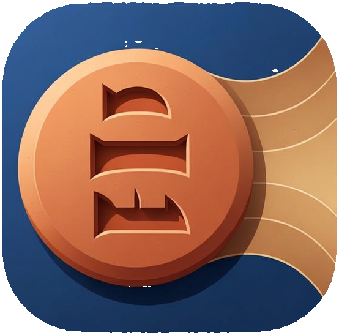

<div align="center">



# Nabu

**Translate English into extinct ancient languages and hear a reconstructed pronunciation.**

Nabu is an open pipeline that takes English text, translates it into an ancient language,
renders it in its original script, converts it to IPA using a published scholarly
reconstruction, and synthesizes speech. Every stage can be used on its own.

[](LICENSE)


</div>

> [!IMPORTANT]
> **Nobody knows exactly how these languages sounded.** There are no recordings of
> Middle Egyptian, Sumerian or Hittite. Everything Nabu speaks is based on a
> **published scholarly reconstruction**, and every output is labeled with the
> reconstruction it follows (for example `egy-allen`). Other scholars reconstruct
> these languages differently.
>
> Translations of modern concepts (computers, airplanes, democracy) are
> **approximations**. The ancient languages had no words for them.
>
> Nabu is an **educational and research tool, not ground truth**. Treat its output
> as one informed hypothesis, not as the way these languages were actually spoken.

## What it does

```
English text
    │
    ▼
┌───────────────────────────────┐
│ 1. Translation                │  LLM + LoRA + RAG
└───────────────────────────────┘
    │  transliteration + confidence score
    ▼
┌───────────────────────────────┐
│ 2. Script rendering           │  sign-list lookup
└───────────────────────────────┘
    │  Unicode hieroglyphs / cuneiform
    ▼
┌───────────────────────────────┐
│ 3. Pronunciation (G2P)        │  rule engine, one YAML file per reconstruction
└───────────────────────────────┘
    │  IPA
    ▼
┌───────────────────────────────┐
│ 4. Speech (TTS)               │  IPA-input VITS model
└───────────────────────────────┘
    │
    ▼
  .wav
```

1. **Translation**: an LLM fine-tuned with LoRA, grounded with retrieval (RAG),
   produces a transliteration and a confidence score.
2. **Script rendering**: the transliteration is mapped to Unicode signs through a
   sign list (Egyptian hieroglyphs, cuneiform).
3. **Pronunciation**: a rule-based grapheme-to-phoneme engine converts the
   transliteration to IPA according to a named reconstruction.
4. **Speech**: a VITS model that takes IPA as input synthesizes a `.wav` file.

Each stage is independent. For example, you can feed a real transliteration from a
published text straight into G2P and TTS, skipping translation entirely.

## Languages

| Language       | Code  | Script                | Reconstruction | Status         |
| -------------- | ----- | --------------------- | -------------- | -------------- |
| Middle Egyptian | `egy` | Egyptian hieroglyphs | `egy-allen`    | 🚧 In progress |
| Sumerian       | `sux` | Cuneiform             | TBD            | 📋 Planned     |
| Hittite        | `hit` | Cuneiform             | TBD            | 📋 Planned     |

## Fully open

Every component uses an OSI-approved license that permits commercial use.
There are **no non-commercial (NC) models or weights** anywhere in the project.

| Component           | Choice                                          | License        |
| ------------------- | ----------------------------------------------- | -------------- |
| Code                | Nabu                                            | Apache-2.0     |
| Base LLM            | Qwen3 family (Apache-2.0 checkpoints only)      | Apache-2.0     |
| Embeddings          | Qwen3-Embedding                                 | Apache-2.0     |
| LLM inference       | llama.cpp                                       | MIT            |
| TTS inference       | ONNX Runtime via onnxruntime_go                 | MIT            |
| Vector store        | PostgreSQL + pgvector                           | PostgreSQL     |
| HTTP router         | chi                                             | MIT            |
| Training            | PyTorch, PEFT, TRL                              | BSD-3, Apache-2.0, Apache-2.0 |
| TTS training audio  | Mozilla Common Voice                            | CC0            |
| Web demo            | React, Vite, TypeScript                         | MIT, MIT, Apache-2.0 |
| Fonts               | Noto Sans Egyptian Hieroglyphs, Noto Sans Cuneiform | OFL-1.1    |

**About text corpora.** The scholarly corpora Nabu learns from (ORACC, CDLI, TLA)
carry their own licenses, and some are share-alike. To respect those terms, Nabu
does **not** redistribute corpus data. Instead it ships tools in [`data/`](data/)
that download and clean the data on your machine. See
[DATA_LICENSES.md](DATA_LICENSES.md) for the terms of each source.

## Why Go?

Everything that runs is Go: the G2P engine, the HTTP API, data tools, evaluation,
and inference (llama.cpp for the LLM, onnxruntime_go for TTS). There is no Python at
request time, and the G2P engine also compiles to
WASM for the browser demo.

Python is confined to `translate/train/` and `tts/train/`, because the model
training ecosystem lives there.

## Repository layout

```
nabu/
├── g2p/                 Go rule engine + CLI (nabu-g2p) + rules/*.yaml
├── api/                 Go HTTP service
├── data/                Go download/cleaning tools (no raw data committed)
├── eval/                Go metrics + held-out test sets
├── translate/train/     Python LoRA fine-tuning
├── tts/train/           Python VITS training + ONNX export
└── web/                 React demo
```

## Quick start

> [!WARNING]
> Nabu is in early development. Interfaces, rule files and output formats will
> change without notice. Only the G2P stage is usable today.

Requires Go.

```sh
git clone https://github.com/<your-username>/nabu
cd nabu

# Transliteration → IPA, using the egy-allen reconstruction
go run ./g2p/cmd/nabu-g2p --rules g2p/rules/egy-allen.yaml "ꜥnḫ"
```

## How we validate

Since there is no audio to compare against, validation checks each stage against
what *can* be checked.

- **Translation**: chrF score on held-out expert translations. Each output word is
  also checked against a dictionary; unknown words lower the confidence score.
- **Pronunciation rules**: unit tests against transliteration → IPA pairs taken from
  the cited reconstruction.
- **Speech**: a phoneme recognizer transcribes the generated audio, and the phoneme
  error rate is measured against the input IPA. This checks that the model says what
  it was asked to say, not that the reconstruction is correct.
- **Expert review**: the real gold standard. If you are an Egyptologist,
  Assyriologist or Hittitologist, your review is the most valuable contribution
  this project can receive. Please open an issue.

## Contributing

- **Philologists**: pronunciation rules are plain YAML in
  [`g2p/rules/`](g2p/rules/). You can edit them without writing code. Please cite
  your sources in the pull request.
- **Reviewers**: if you spot a wrong translation, sign or pronunciation, open an
  issue. Citations help, but are not required to report a problem.
- **Engineers**: look for issues labeled `good first issue`.

See [CONTRIBUTING.md](CONTRIBUTING.md) for details.

## Why "Nabu"?

Nabu was the Mesopotamian god of scribes, writing and wisdom. His symbol was the
stylus used to press wedges into clay.

## License

Code is licensed under [Apache-2.0](LICENSE). Model weights follow whatever license
their training data requires; each model card states it.
